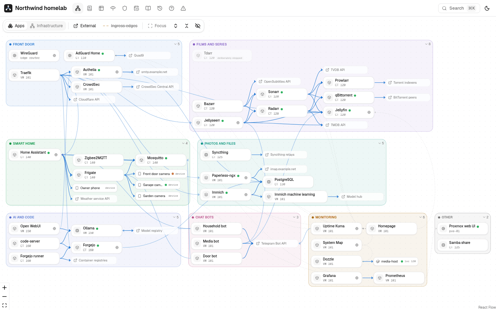
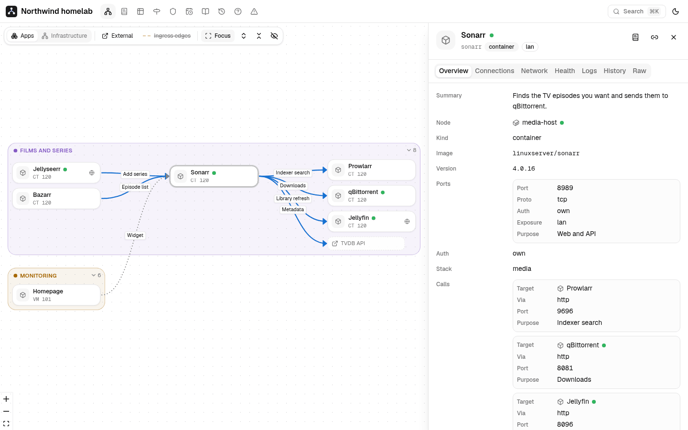
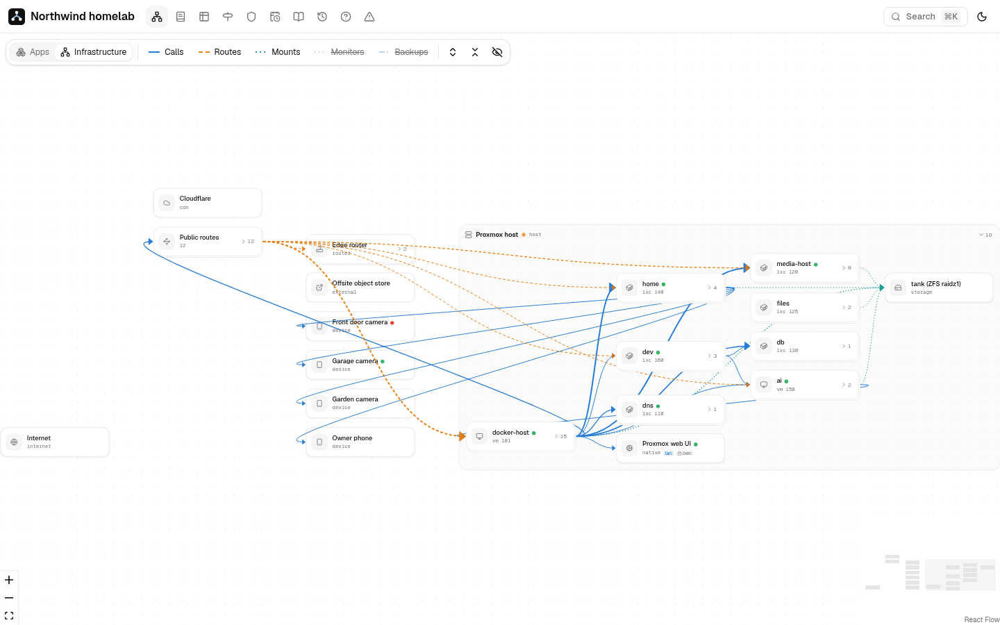
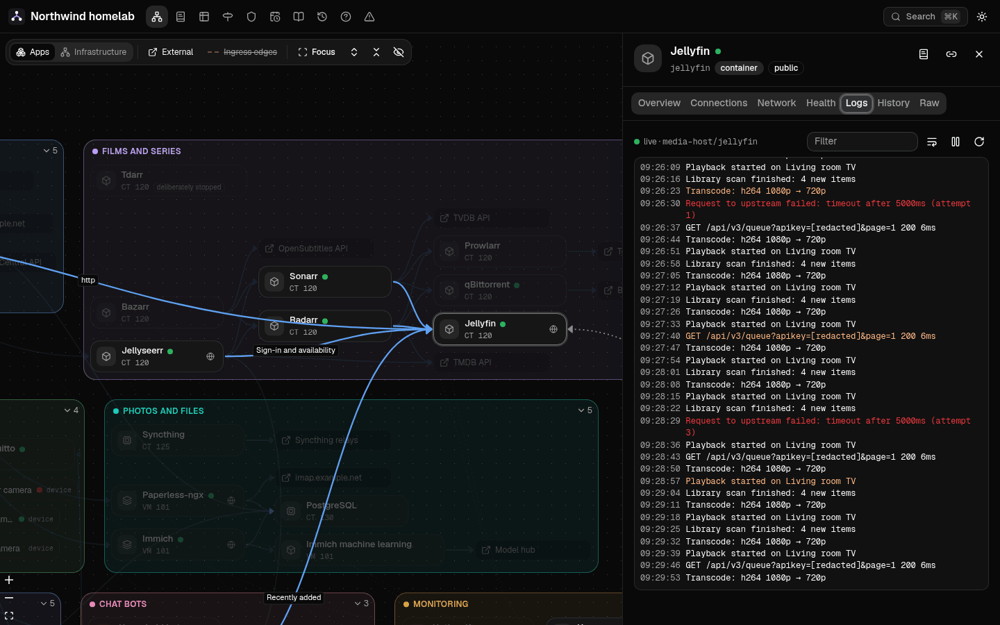
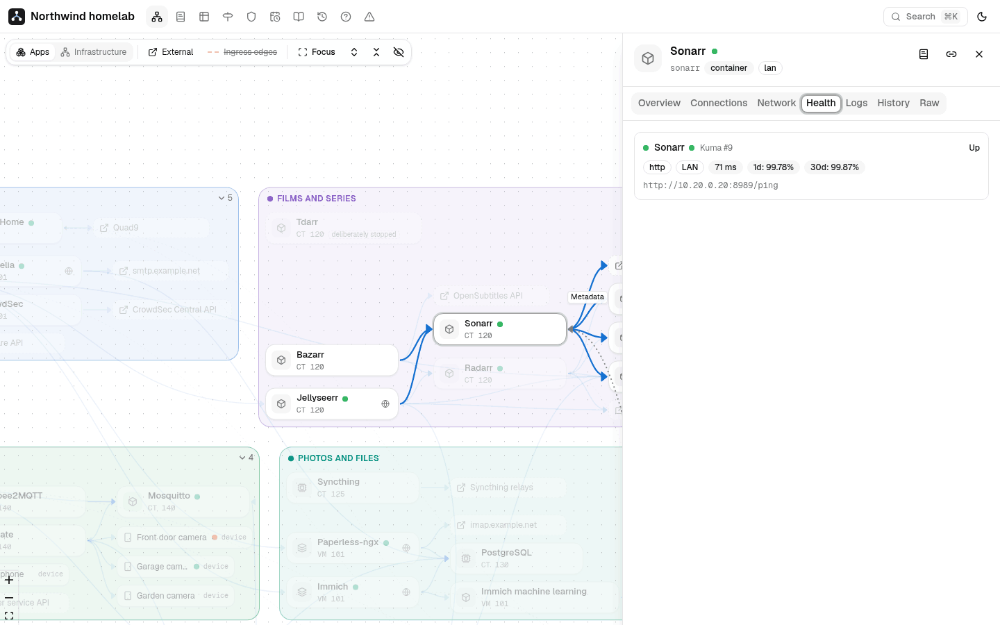
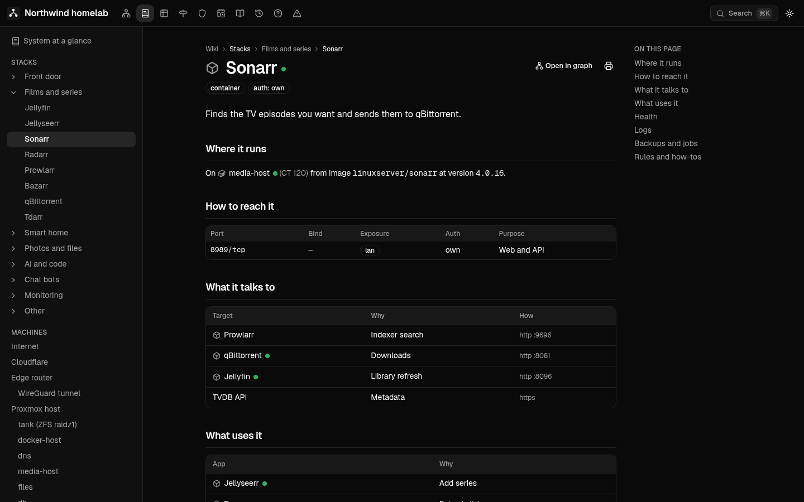
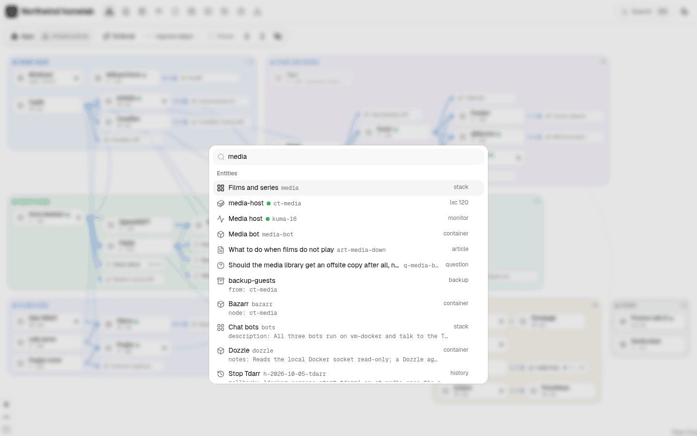
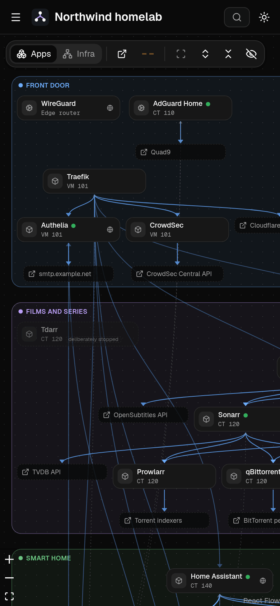

# System Map

[](https://github.com/mrRedSun/system-map/actions/workflows/ci.yml)
[](https://github.com/mrRedSun/system-map/pkgs/container/system-map)
[](LICENSE)

**A live map and wiki of your homelab, generated from a folder of YAML files.**

<picture>
  <source media="(prefers-color-scheme: dark)" srcset="docs/screenshots/apps-dark.png">
  
</picture>

## Why

A homelab grows one container at a time, and after a while nobody remembers how it fits together:
which app talks to which, what is exposed, where the data lives, what to do when something breaks.

System Map keeps that knowledge in plain YAML next to your other config: hosts, guests, apps,
routes, firewall rules, jobs, backups, policies, history. You (or an agent) edit the files; the map
reloads on save. It never writes to them and never needs credentials, only the locations of secrets.

On top of the files it shows live health from Uptime Kuma and live logs from Dozzle, so the map is
also the first place to look when something is down.

## Features

|                                                                                                                                                                                                                                              |                                                                                                                                                                                                                 |
| -------------------------------------------------------------------------------------------------------------------------------------------------------------------------------------------------------------------------------------------- | --------------------------------------------------------------------------------------------------------------------------------------------------------------------------------------------------------------- |
| **Apps graph.** One card per app, grouped by stack, with calls as arrows from caller to callee. Click an app to highlight its neighbours; `f` hides the rest. <br><br>  | **Infrastructure view.** The host, its guests and what runs inside them, with routes, mounts, monitors and backups. <br><br>                                  |
| **Live logs.** Tail any container you declared, straight from Dozzle, with keys and tokens masked on the server. <br><br>                                                 | **Health.** Uptime Kuma status, response time and uptime on every app and the machines it runs on. <br><br>                                                           |
| **Wiki.** Readable pages generated from the same data: what each app does, how to reach it, what it depends on, backups, history, plus your own articles. <br><br>                    | **Search and tables.** ⌘K finds ids, names, IPs, ports, hostnames and notes. Tables for entities, routes, firewall, jobs, policies and history. <br><br>  |

Also: validation with file and line for every problem (a broken file never takes the page down),
deep links for everything, dark mode, and a layout that works on a phone.

<p align="center"></p>

## Quick start

With Docker, using the fictional showcase data in this repository:

```sh
git clone https://github.com/mrRedSun/system-map.git && cd system-map
docker run --rm -p 8080:8080 -v "$PWD/examples/showcase:/data:ro" ghcr.io/mrredsun/system-map:main
```

Open http://localhost:8080. Health and logs stay empty because no Uptime Kuma or Dozzle is
configured. To see them too, run the demo, which starts small mock servers for both (needs Node 22):

```sh
npm ci
npm run demo                 # builds and runs from source; add -- --docker to run the image instead
```

## Your data

Start with one file and grow from there:

```yaml
# yaml-language-server: $schema=https://raw.githubusercontent.com/mrRedSun/system-map/main/schema/system-map.schema.json
version: 1
meta: { title: My homelab }
nodes:
  - { id: pve, kind: host, name: Proxmox host }
  - { id: ct-media, kind: lxc, parent: pve, vmid: 120 }
services:
  - id: jellyfin
    name: Jellyfin
    node: ct-media
    kind: container
    summary: Streams films and series to the TV and phones.
    ports: [{ port: 8096, exposure: lan }]
    health: { kuma: [kuma-jellyfin] }
    logs: { dozzle: { host: media, container: jellyfin } }
monitors:
  - { id: kuma-jellyfin, kuma_id: 12, name: Jellyfin }
```

- Every `*.yaml` in the data directory is read in name order and merged; split by topic as you like.
- The [JSON Schema](schema/system-map.schema.json) gives editors completion and checks.
  [docs/data.md](docs/data.md) explains ids, references, stacks, the wiki fields and the problems
  the app reports.
- `docker run --rm -v "$PWD/data:/data:ro" ghcr.io/mrredsun/system-map:main /app/validate.mjs --strict`
  checks a directory and exits non-zero on problems.
- [examples/showcase](examples/showcase) is a complete fictional homelab to copy from.

## Deployment

Run it with Docker Compose behind your reverse proxy. **System Map has no login: authentication must
happen upstream** (for example Traefik with Authelia or another SSO). Do not publish its port
directly. [compose.example.yaml](compose.example.yaml) has a hardened setup (read-only root file
system, no capabilities, non-root user, resource limits) and a Traefik router with an auth
middleware. Deploy an immutable `sha-<commit>` tag; [docs/deployment.md](docs/deployment.md) covers
upgrades, rollback and backups.

## Configuration

| Variable            | Default | Meaning                                             |
| ------------------- | ------- | --------------------------------------------------- |
| `DATA_DIR`          | `/data` | Directory with the YAML files, mounted read-only.   |
| `PORT`              | `8080`  | Listen port.                                        |
| `KUMA_URL`          | unset   | Uptime Kuma 2.x base URL. Unset disables health.    |
| `KUMA_API_KEY_FILE` | unset   | File with a Kuma API key, if `/metrics` needs auth. |
| `DOZZLE_URL`        | unset   | Dozzle hub URL. Unset disables logs.                |
| `LOG_LEVEL`         | `info`  | `info`, `warn` or `error`; logs are JSON lines.     |

Details on the Kuma and Dozzle integrations: [docs/configuration.md](docs/configuration.md).

## Limitations and roadmap

- Read-only by design: the map shows the data, it does not edit it.
- Health needs Uptime Kuma 2.0 or newer (`/metrics` with monitor ids); logs need a Dozzle v11 hub.
- One data directory per instance, `linux/amd64` images only.
- Possible next steps: more health sources, a printable full-wiki export, multi-arch images.

## More

- [Architecture](docs/architecture.md): how the server, the shared schema and the web app fit
  together, and the HTTP API.
- [Contributing](CONTRIBUTING.md): development setup, tests, the demo and screenshots.
- [Security policy](SECURITY.md)

## License

[MIT](LICENSE)
